# Project 6 - CI

## Part 4 - Project Description & Diagram

### Continuous Integration Project Overview

**Project Goal**
The goal of this project is to take my website from project 5, put it into an apache docker container.
as well as use DockerHub and GitHub Actions to automate it. GitHub will automatically push the version control
to DockerHub so i can track versions or roll back to older ones.

**Tools Used**
- **Git & GitHub:** Version control for my code and creating git tags to mark releases.
- **Docker:** Packages the website files into an `httpd:2.4` container image and runs the containers locally for testing.
- **GitHub Actions:** Runs the automated workflow in the cloud whenever a new version tag is pushed to the repo.
- **DockerHub:** Stores the built container images in my public repo so they can be pulled and run from anywhere.

**Project Diagram**

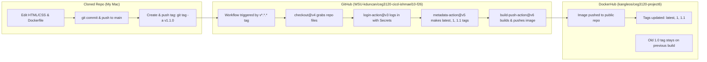

**What is Not Working**
Everything required for the project is working.

---

## Part 1 - Create a Docker Container Image

### Dockerfile & Building Images

**Website Content**
My site files are in the [`web-content`](web-content) folder:
- [`web-content/index.html`](web-content/index.html) - The main page of my site with the welcome header, test text for version updates, and a link to page 2.
- [`web-content/page2.html`](web-content/page2.html) - The second HTML page to test multi-page links inside the container.
- [`web-content/style.css`](web-content/style.css) - The CSS file that styles both pages.

**Dockerfile**
The [`Dockerfile`](Dockerfile) in the root of my repo only needs two lines:
- `FROM httpd:2.4` sets the base image to Apache 2.4.
- `COPY ./web-content/ /usr/local/apache2/htdocs/` copies everything inside my `web-content` folder into Apache's default web directory inside the container.

**Building and Running the Image**
To push an image to DockerHub, the image tag has to start with my DockerHub username followed by the repo name (`<username>/<repo>:<tag>`).

To build the image from the root folder of the repo:
```bash
docker build -t kangleos/ceg3120-project6:latest .
```

To log into DockerHub on the terminal (using my PAT as the password) and push the image:
```bash
docker login -u kangleos
docker push kangleos/ceg3120-project6:latest
```

To pull and run the container on port 8080:
```bash
docker pull kangleos/ceg3120-project6:latest
docker run -d -p 8080:80 --name test-web kangleos/ceg3120-project6:latest
```
After running that command, the site loads in my browser at `http://localhost:8080/index.html` and `http://localhost:8080/page2.html`.

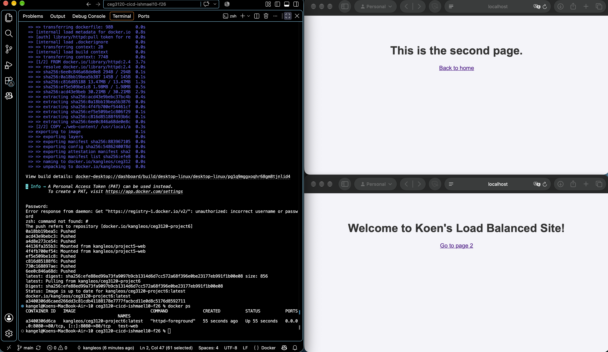
This screenshot shows my container is running in `docker ps` and serving both `index.html` and `page2.html` locally with the CSS working.

---

## Part 2 - GitHub Actions and DockerHub

### Configuring GitHub Repository Secrets

**Creating a DockerHub PAT**
1. Log into DockerHub and go to **Account Settings** > **Personal access tokens**.
2. Click **Generate new token**, name it, and set the access permissions to **Read & Write** (Read & Write is the best scope for this project since GitHub Actions only needs to pull and push images, not delete repos).
3. Generate the token and copy it right away since DockerHub won't show it again.

**Setting Repository Secrets**
1. In the GitHub repo, go to **Settings** > **Secrets and variables** > **Actions**.
2. Click **New repository secret** and add these two secrets:
   - `DOCKER_USERNAME`: My DockerHub username (`kangleos`).
   - `DOCKER_TOKEN`: The Personal Access Token I generated on DockerHub so the workflow can log in without putting my password in the code.

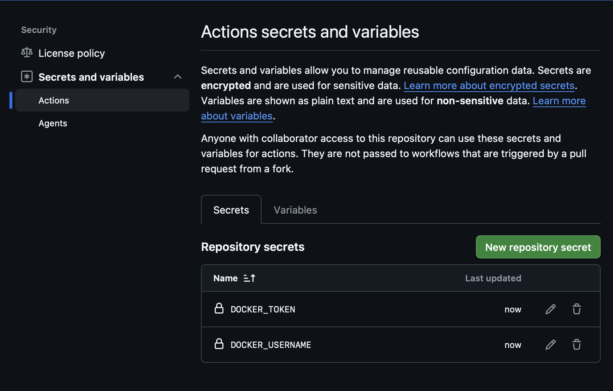
This screenshot proves `DOCKER_USERNAME` and `DOCKER_TOKEN` are saved in my GitHub Actions repository secrets.

### CI with GitHub Actions

- **Part 2 Workflow Permalink:** [docker-publish.yml at commit `b948917`](https://github.com/WSU-kduncan/ceg3120-cicd-ishmael10-f26/blob/b948917/.github/workflows/docker-publish.yml)

**Workflow Trigger and Steps**
- **Trigger:** Set to `on: push: branches: [ main ]` so the workflow only runs when a commit is pushed to `main` (and ignores other branches).
- **Step 1 (`actions/checkout@v4`):** Pulls my repo code into the runner VM so it can access the `Dockerfile` and `web-content` folder.
- **Step 2 (`docker/login-action@v3`):** Logs into DockerHub using the `DOCKER_USERNAME` and `DOCKER_TOKEN` secrets.
- **Step 3 (`docker/build-push-action@v6`):** Builds the image from my `Dockerfile` and pushes it to `kangleos/ceg3120-project6:latest`.

**Values to Change for a Different Repository**
- **In the workflow file:** You would need to change the repo name under `tags:` from `ceg3120-project6` to whatever the new DockerHub repo is named (and change `main` under `branches:` if the other repo uses a different main branch name).
- **In the GitHub repository:** You have to go into **Settings** > **Secrets and variables** > **Actions** in the new repo and add `DOCKER_USERNAME` and `DOCKER_TOKEN` there too.

### Testing & Validating

- **DockerHub Repository:** [https://hub.docker.com/r/kangleos/ceg3120-project6](https://hub.docker.com/r/kangleos/ceg3120-project6)

To test that the workflow worked:
1. Push a change to `main` and check the **Actions** tab on GitHub to make sure the build finishes with a green checkmark.
2. Check DockerHub to see that the `latest` tag was just updated.
3. Pull the new image and run it locally (since I'm on an Apple Silicon Mac and GitHub builds `amd64` images, I used `--platform linux/amd64` when pulling and running):
   ```bash
   docker pull --platform linux/amd64 kangleos/ceg3120-project6:latest
   docker run --platform linux/amd64 -d -p 8080:80 --name test-change kangleos/ceg3120-project6:latest
   ```
4. Open `http://localhost:8080` in a browser and check that the updated text on `index.html` shows up.

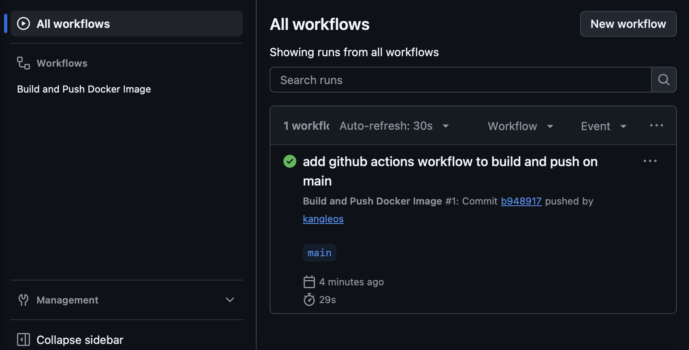
This screenshot proves that pushing to `main` triggered a successful workflow run with the commit SHA visible.

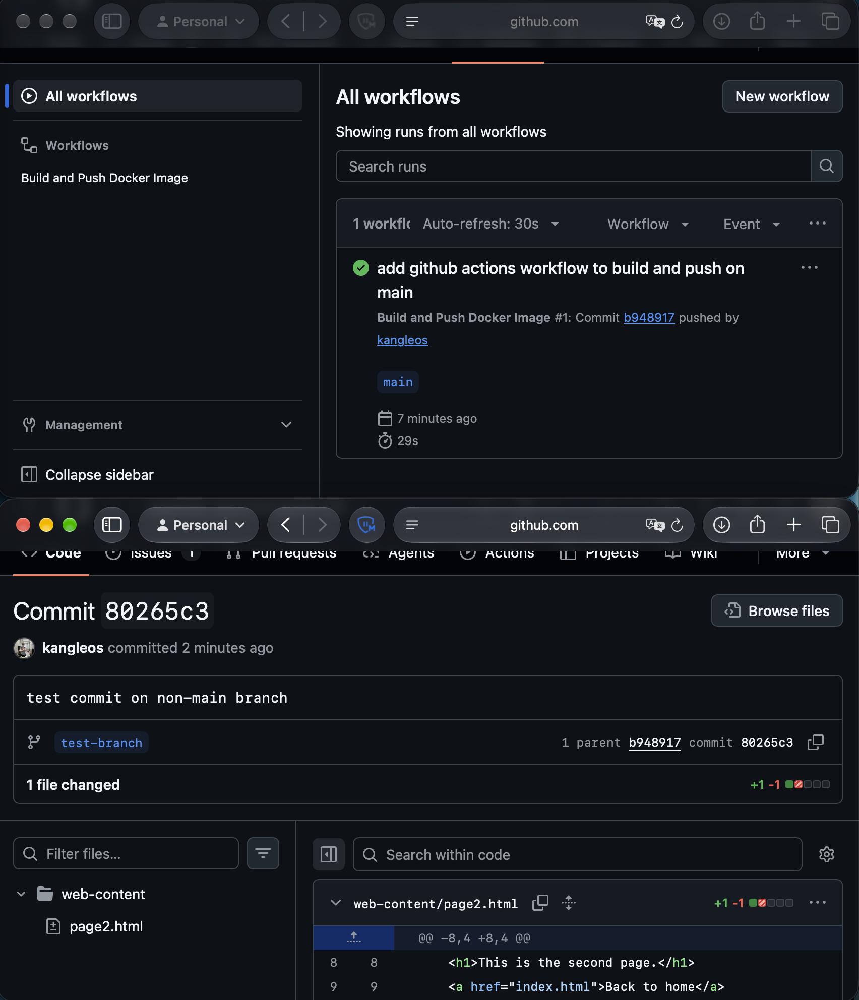
This screenshot proves that pushing a commit to `test-branch` did not trigger a workflow run.

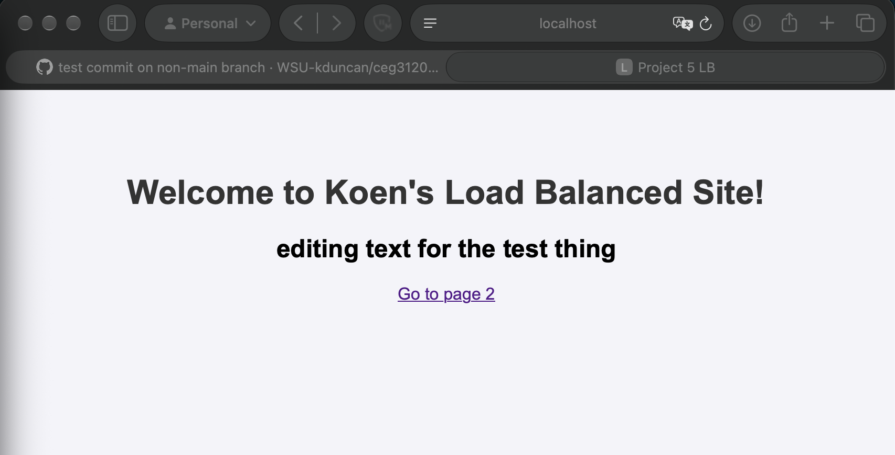
This screenshot proves that after editing `index.html` and pushing to `main`, pulling and running the updated image from DockerHub shows the new text in my browser.

---

## Part 3 - Semantic Versioning

### Generating `tag`s

- **How to see existing tags in a git repo:**
  ```bash
  git tag -l
  ```
- **How to create an annotated tag on the current commit:**
  ```bash
  git tag -a v1.0.0 -m "release version 1.0.0"
  ```
- **How to push a tag to GitHub:**
  ```bash
  git push origin v1.0.0
  ```

### Semantic Versioning Container Images with GitHub Actions

- **Part 3 Workflow File:** [`.github/workflows/docker-publish.yml`](.github/workflows/docker-publish.yml)

**Workflow Trigger and Steps**
- **Trigger:** Changed to `on: push: tags: [ 'v*.*.*' ]` so normal commits to `main` don't run the action anymore—it only runs when a version tag like `v1.0.0` or `v1.1.0` is pushed.
- **Step 1 (`actions/checkout@v4`):** Checks out the repo at the tagged commit.
- **Step 2 (`docker/login-action@v3`):** Logs into DockerHub using my `DOCKER_USERNAME` and `DOCKER_TOKEN` secrets.
- **Step 3 (`docker/metadata-action@v5`):** Reads the git tag version and generates three tags for DockerHub: `major` (like `1`), `major.minor` (like `1.0`), and `latest`.
- **Step 4 (`docker/build-push-action@v6`):** Builds the image and pushes it to DockerHub with all the tags generated by the metadata step (`${{ steps.meta.outputs.tags }}`).

**Values to Change for a Different Repository**
- **In the workflow file:** Update the `images:` line inside the `docker/metadata-action@v5` step to match the new DockerHub repo name.
- **In the GitHub repository:** Set the `DOCKER_USERNAME` and `DOCKER_TOKEN` secrets in the new repository's Actions settings.

### Testing & Validating

- **DockerHub Tags Page:** [https://hub.docker.com/r/kangleos/ceg3120-project6/tags](https://hub.docker.com/r/kangleos/ceg3120-project6/tags)

To test and verify semantic versioning:
1. Push a regular commit to `main` without a tag and check the **Actions** tab to make sure no workflow starts.
2. Create and push `v1.0.0`, wait for the action to finish, and check DockerHub to verify `latest`, `1`, and `1.0` were created.
3. Change the text in `index.html`, commit, and push `v1.1.0`. Check DockerHub to see that `latest`, `1`, and `1.1` share the new digest while `1.0` still points to the old image digest.
4. Pull and run both `:1.0` and `:1.1` on ports 8081 and 8082 to verify that `:1.0` still serves the older site and `:1.1` serves the updated site:
   ```bash
   docker run --platform linux/amd64 -d -p 8081:80 --name site-v1-0 kangleos/ceg3120-project6:1.0
   docker run --platform linux/amd64 -d -p 8082:80 --name site-v1-1 kangleos/ceg3120-project6:1.1
   ```

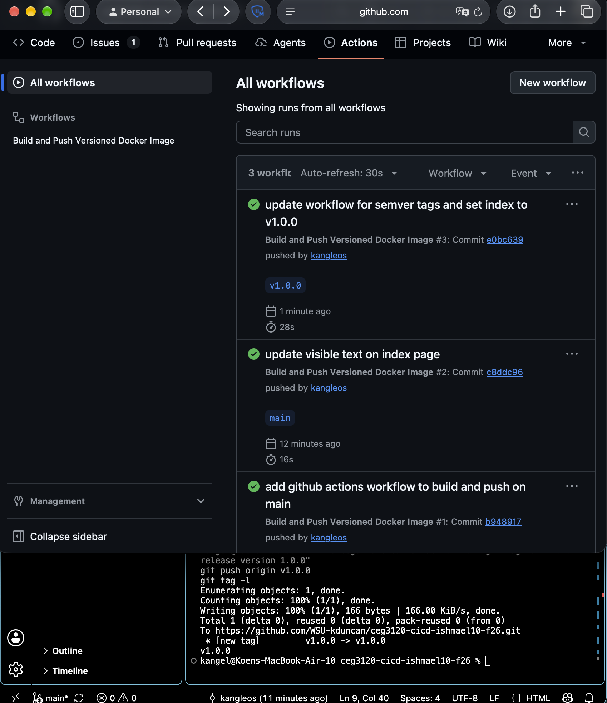
This screenshot shows my `git tag -l` output and proves that pushing a tag triggered a successful workflow run.

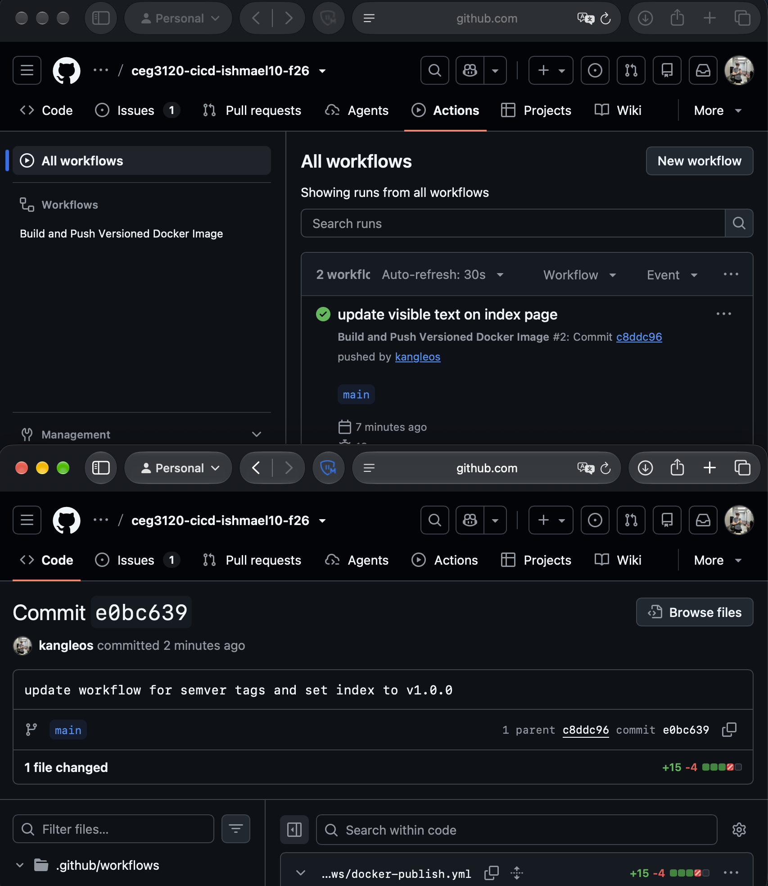
This screenshot proves that pushing a commit to `main` without a tag did not start a workflow run.

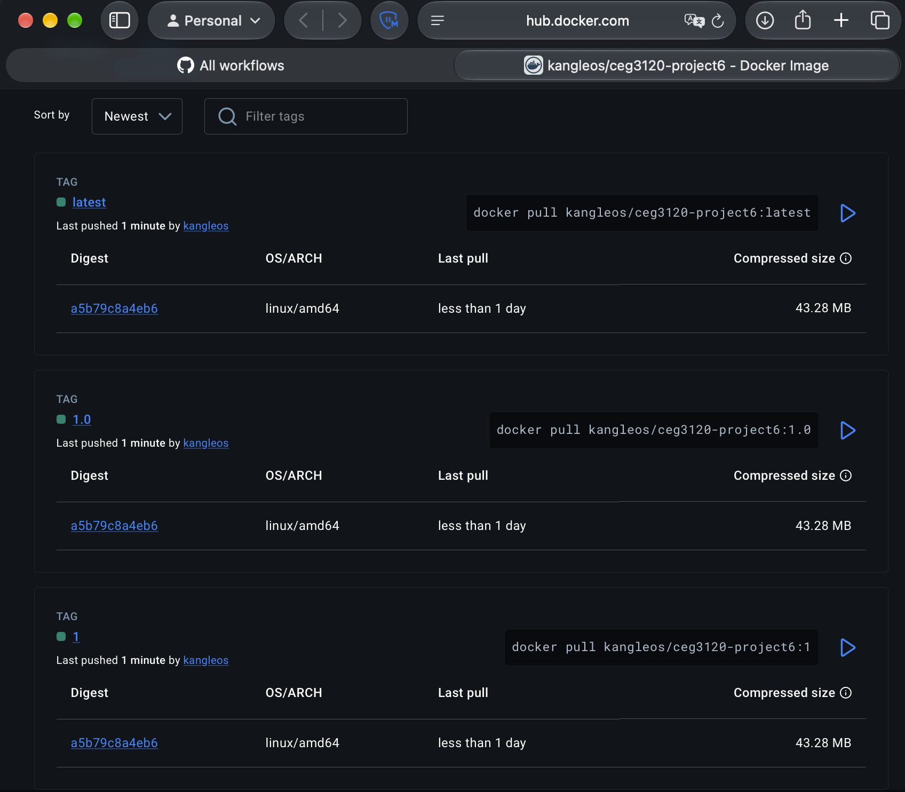
This screenshot proves DockerHub received the `latest`, `major` (`1`), and `major.minor` (`1.0`) tags from the workflow.

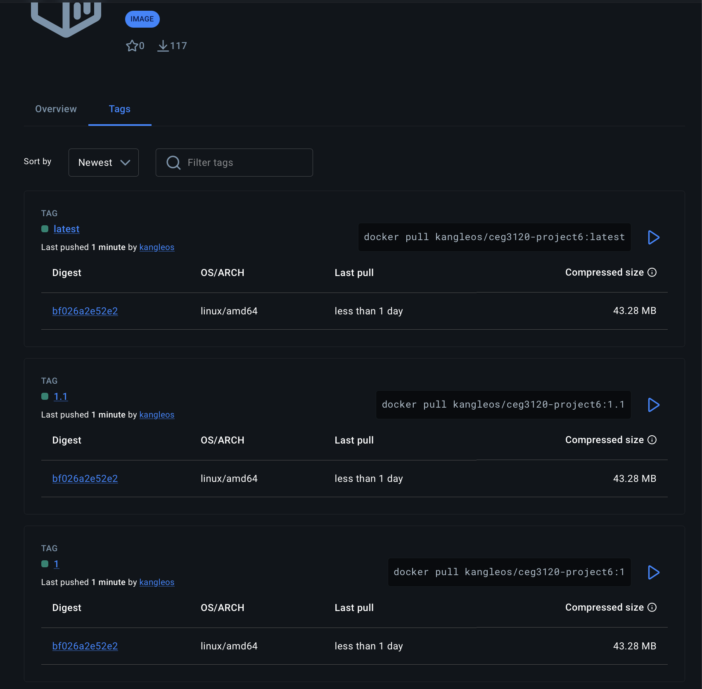
This screenshot proves that after releasing `v1.1.0`, the `1`, `1.1`, and `latest` tags moved to the new image digest while `1.0` stayed on the old digest.

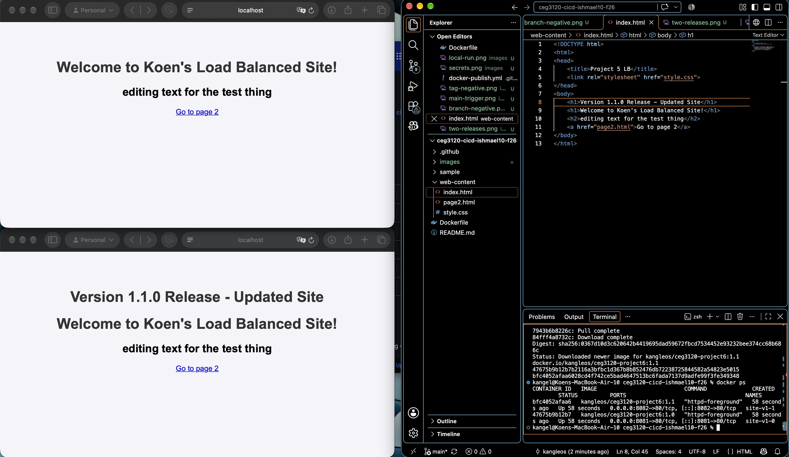
This screenshot proves that running `:1.0` on port 8081 and `:1.1` on port 8082 serves the `v1.0.0` version and `v1.1.0` version of the site at the same time.

---

## Resources

- [Docker Docs - CI/CD with GitHub Actions](https://docs.docker.com/build/ci/github-actions/) - Used to set up the login, metadata, and build-push steps in `.github/workflows/docker-publish.yml`.
- [GitHub Marketplace - docker/metadata-action](https://github.com/docker/metadata-action?tab=readme-ov-file#semver) - Used to check the syntax for generating `{{major}}` and `{{major}}.{{minor}}` semver tags.
- [DockerHub - Official httpd Image Docs](https://hub.docker.com/_/httpd) - Used to check the `/usr/local/apache2/htdocs/` path for the `Dockerfile`.
- **Google Gemini:** Used to help figure out the `--platform linux/amd64` flag when pulling images on my MacBook, check the `docker/metadata-action@v5` YAML formatting, and structure the Mermaid diagram. Prompts used: "help me structure a mermaid diagram for this" "whats happening with my terminal Docker commands" "double check my formatting for this pretty please".